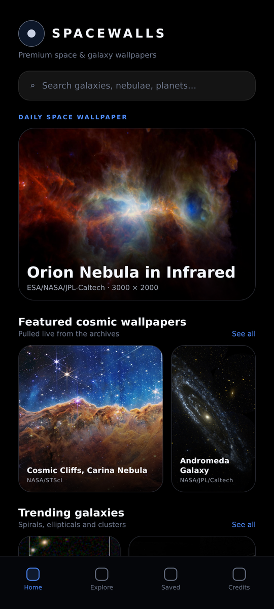
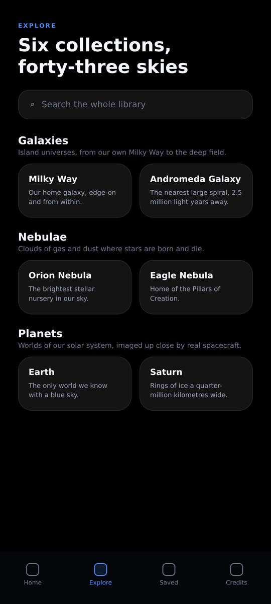
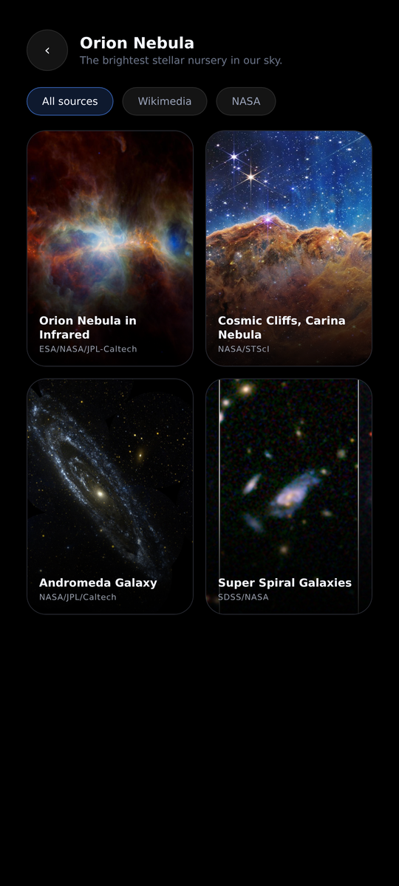
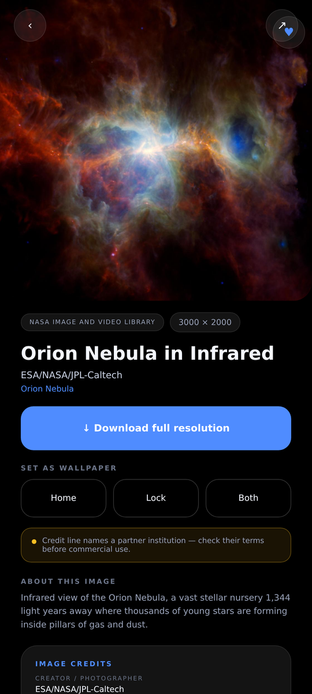
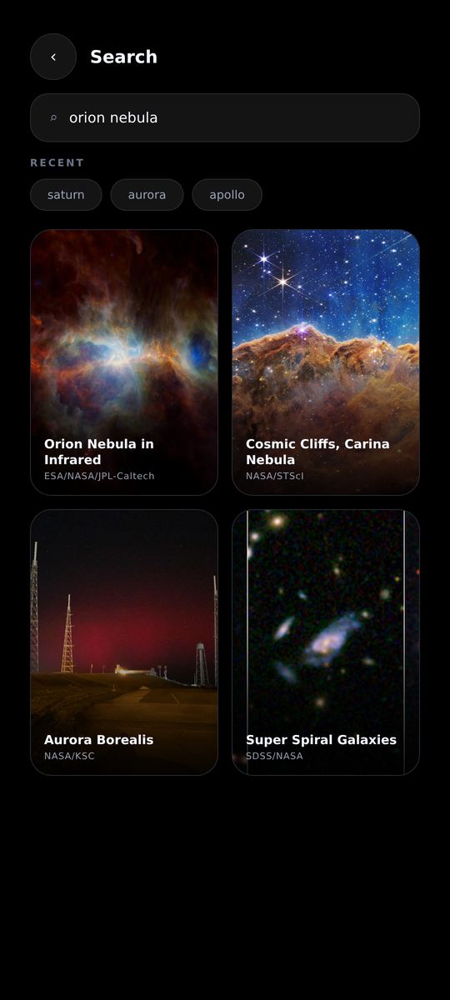
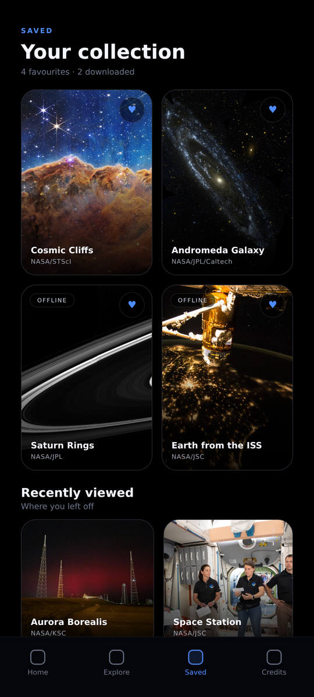
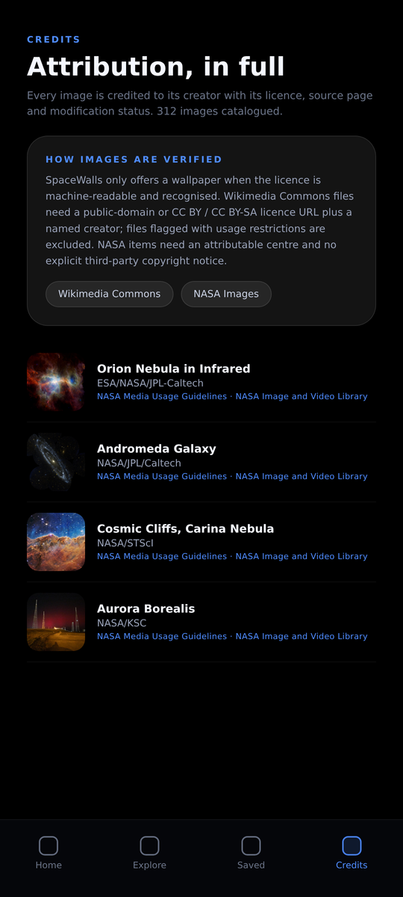

# SpaceWalls — Premium Space & Galaxy Wallpaper App

A production-quality Android wallpaper app built with Kotlin, Jetpack Compose and Material 3.
Every wallpaper is real space imagery fetched live from **Wikimedia Commons** and the
**NASA Image and Video Library**, with its full attribution block retrieved from the source.

There is no bundled image library: the entire catalogue is a set of live API queries, so the
imagery stays current every time the app opens.

## Screens

| Home | Explore | Collection |
|---|---|---|
|  |  |  |

| Detail | Search | Saved |
|---|---|---|
|  |  |  |



> These previews are rendered from the app's design tokens (same layout, AMOLED palette,
> type scale and components as the Compose screens) using real public-domain NASA imagery.
> They are not device captures — install the APK to see the live app.


---

## 1. What it does

| Area | Implementation |
|---|---|
| Live catalogue | Wikimedia Commons `action=query` + NASA `images-api.nasa.gov/search`, fetched on every screen load |
| Categories | 6 groups / 43 collections, each with provider-specific queries (`SpaceCatalog.kt`) |
| Search | Live search across both providers, local Room fallback, recent searches |
| Wallpaper setting | `WallpaperManager` → home, lock, or both (API 24+) |
| Downloads | OkHttp streaming into app storage + MediaStore publish to `Pictures/SpaceWalls`, run in WorkManager |
| Favourites | Room, survive restarts, shown on the Saved tab |
| Offline | Room mirror of every image ever seen + downloaded files load from disk |
| Daily wallpaper | Deterministic daily pick from the verified pool, rolled forward by a 6-hourly worker |
| Duplicate prevention | Unique `(source, remoteId)` index + per-image unique work name + on-disk file check |
| Pagination | Wikimedia `gsroffset` continuation, NASA `page`, infinite scroll in grids |
| Performance | Coil memory/disk caching, thumbnail URLs for grids, sampled bitmap decoding for wallpaper writes |

### Screens

1. **Home** — logo, search entry, daily space wallpaper hero, featured, trending galaxies, popular planets, nebulae, deep space, exploration, recently added.
2. **Explore** — all six collections with blurbs.
3. **Collection** — paged grid with All / Wikimedia / NASA filters.
4. **Search** — live results, recent searches, paging.
5. **Detail** — full-screen preview, title, collection, resolution, creator, licence, description,
   download with progress, set home / lock / both, favourite, share, credits card, links to the
   original image page and the licence.
6. **Saved** — favourites, offline downloads, recently viewed.
7. **Credits** — every catalogued image with creator, licence and source, plus the verification policy.

---

## 2. Attribution and licensing

This is the part the app is strictest about. A file becomes a wallpaper **only** when its rights
are machine-verifiable; otherwise it is dropped before it reaches the UI.

`LicensePolicy.kt` enforces:

**Wikimedia Commons**
- `extmetadata` must contain a licence that resolves to public domain / CC0, or a
  `creativecommons.org/licenses/by|by-sa/…` URL. `by-nc` / `by-nd` variants are rejected.
- Files with a non-empty `Restrictions` field (trademark, personality, etc.) are rejected.
- CC BY / CC BY-SA files must name a creator — an unattributable CC file is rejected.
- Only `image/jpeg`, `image/png`, `image/webp` are accepted.
- Minimum 1600 px long edge and 900 px short edge, so wallpapers are not upscaled mush.

**NASA Image and Video Library**
- The item must name a NASA centre (so the credit line is attributable).
- The original asset URL must come from `images-assets.nasa.gov` / `images.nasa.gov`.
- Items whose title, description or credit contains `©`, "copyright", "all rights reserved",
  or a stock-agency name are rejected.
- Items whose credit names a partner institution (ESA, ESO, JAXA, STScI, AURA, CfA, …) are
  kept but flagged `THIRD_PARTY_CREDIT`, and the detail screen shows that advisory.

**Displayed for every image**: title, creator, credit line, source name, original image page,
licence name, licence URL, usage terms, resolution, date, modification statement and rights note.

`CREDITS.md` documents the policy in prose; the in-app Credits tab lists every image the app has
catalogued, and each detail screen has an "Image credits" card with tappable source and licence links.

> NASA does not endorse this app. NASA material is generally not subject to copyright in the
> United States, but individual items may contain third-party material — which is exactly why
> the third-party markers above exist.

---

## 3. Architecture

```
app/src/main/java/com/spacewalls/app/
├── SpaceWallsApp.kt          Application, Coil ImageLoader, worker scheduling
├── MainActivity.kt           Single activity, edge-to-edge Compose host
├── di/AppContainer.kt        Explicit dependency container + CompositionLocal
├── data/
│   ├── model/                Wallpaper, ImageSource, RightsStatus, SpaceCatalog (43 collections)
│   ├── remote/               OkHttp/Retrofit, UA header, freshness interceptor, NetworkMonitor
│   │   ├── wikimedia/        Commons API interface + DTOs
│   │   └── nasa/             NASA Images API interface + DTOs (+ asset manifest)
│   ├── license/LicensePolicy.kt      Rights verification gate
│   ├── mapper/WallpaperMappers.kt    DTO → domain, HTML flattening, credit assembly
│   ├── local/                Room entity/DAO/database, DataStore prefs
│   ├── repo/                 WallpaperRepository (live paging + cache), DownloadRepository
│   ├── wallpaper/            WallpaperManager wrapper with sampled decoding
│   └── work/                 DownloadWorker, DailyRefreshWorker, WorkScheduler
├── ui/                       theme, shared components, 7 screens, one ViewModel each
└── util/                     HTML text cleanup, share helper
```

**Data flow** — `Screen → ViewModel → WallpaperRepository → (Wikimedia ∥ NASA in parallel) →
LicensePolicy → mapper → Room upsert → StateFlow → Compose`.

Both providers are queried concurrently per page; results are interleaved, de-duplicated by id and
by normalised title, then cached. If both providers fail, the screen falls back to cached rows and
says so — it never invents content.

**Stack**: Kotlin 2.0.21 · Compose BOM 2024.09.03 · Material 3 · Room 2.6.1 (KSP) ·
Retrofit 2.11 + Gson · OkHttp 4.12 · Coil 2.7 · WorkManager 2.9 · DataStore 1.1 ·
Navigation Compose 2.8 · AGP 8.6.1 · Gradle 8.7 · minSdk 24 · target/compileSdk 35.

---

## 4. Building

Requirements: JDK 17, Android SDK Platform 35 + Build-Tools 35.

```bash
# Android Studio: File ▸ Open ▸ this folder, let Gradle sync, Run 'app'.

# Command line:
./gradlew :app:assembleDebug
# → app/build/outputs/apk/debug/app-debug.apk
```

`local.properties` is generated by Android Studio (`sdk.dir=/path/to/Android/sdk`).

### Release build

Create an upload key and point Gradle at it:

```bash
keytool -genkeypair -v -keystore spacewalls-release.jks \
  -alias spacewalls -keyalg RSA -keysize 4096 -validity 10000
```

Add a `signingConfigs { create("release") { … } }` block to `app/build.gradle.kts` (or use
Android Studio's *Generate Signed App Bundle* wizard). R8 rules for Retrofit/Gson DTOs are already
in `app/proguard-rules.pro`.

---

## 5. API endpoints used

| Provider | Endpoint |
|---|---|
| Wikimedia search | `https://commons.wikimedia.org/w/api.php?action=query&generator=search&gsrsearch=filetype:bitmap <q>&gsrnamespace=6&prop=imageinfo&iiprop=url|size|mime|extmetadata&iiurlwidth=1000` |
| NASA search | `https://images-api.nasa.gov/search?q=<q>&media_type=image&page=<n>&page_size=<n>` |
| NASA assets | the item's `href` manifest (`https://images-assets.nasa.gov/image/<id>/collection.json`) |

A descriptive `User-Agent` is sent on every request, as both providers' etiquette guidelines ask.

---

## 6. Behaviour notes

- Catalogue calls send `Cache-Control: no-cache`; image bytes are cached by Coil.
- Downloads are one-off WorkManager jobs with `ExistingWorkPolicy.KEEP`, so tapping twice never
  duplicates a file; an existing file short-circuits the download.
- The daily wallpaper is chosen by `dayOfYear % poolSize`, so it changes daily and never repeats
  within a cycle, using only verified images.
- Wallpapers are decoded with a sample size matched to the screen before being handed to
  `WallpaperManager`, keeping full-resolution files off the heap.
- The 6-hourly `DailyRefreshWorker` rotates through collections so the library refreshes itself
  even if the app is not opened.
