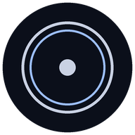
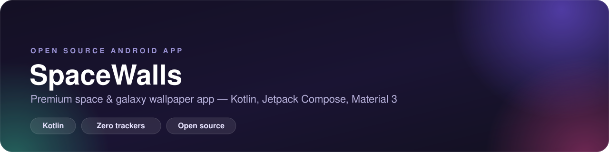
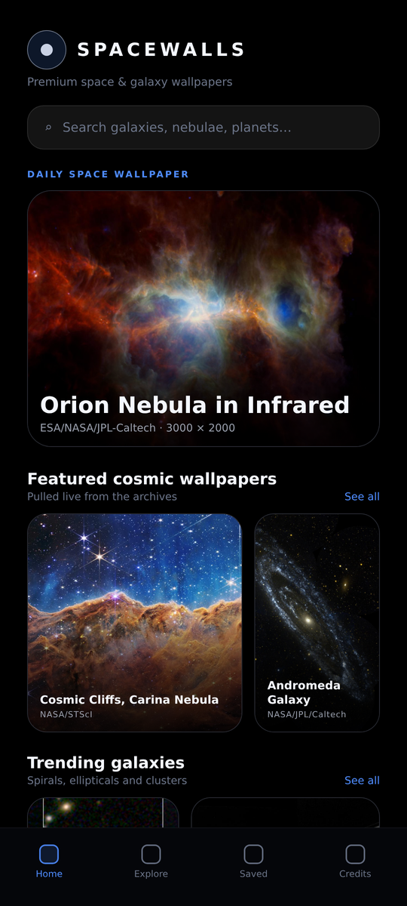
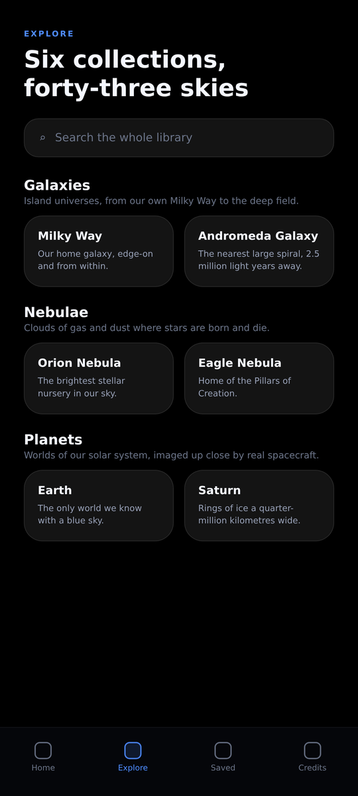
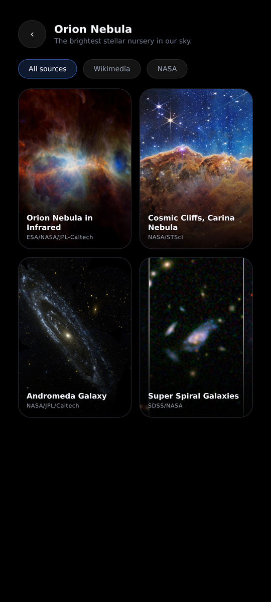
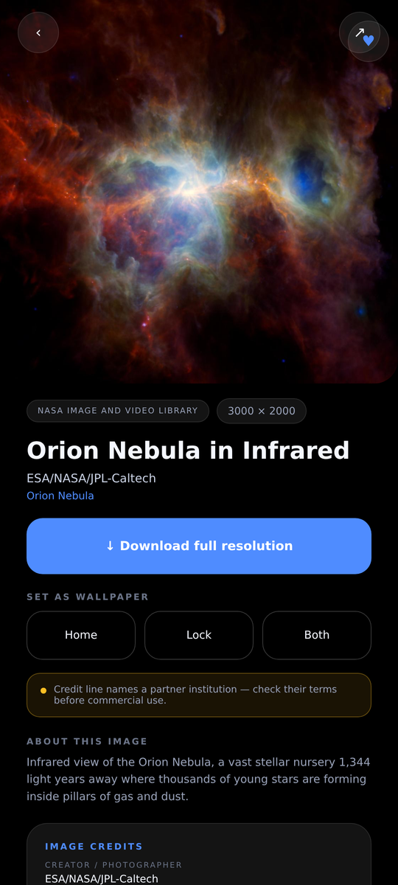
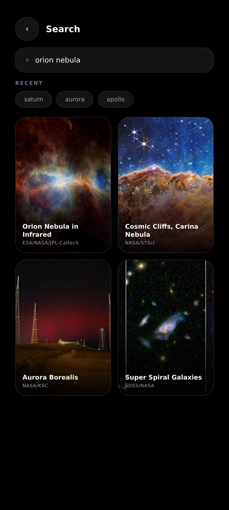
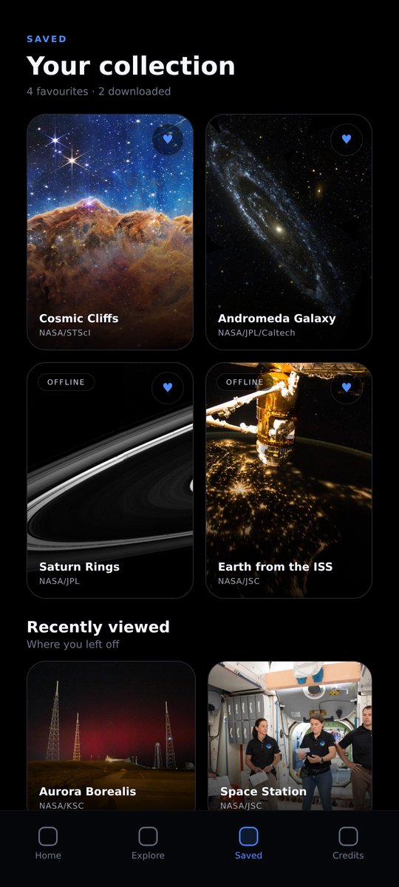
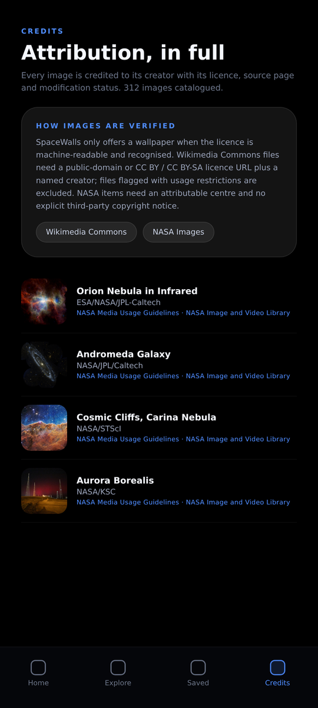

<div align="center">





<a href="https://github.com/technicalnihilist-lgtm/SpaceWalls/stargazers"></a>&nbsp;<a href="https://github.com/technicalnihilist-lgtm/SpaceWalls/network/members"></a>

<a href="https://github.com/technicalnihilist-lgtm/SpaceWalls/releases/latest/download/SpaceWalls-1.0.1-debug.apk"></a> <a href="https://technicalnihilist-lgtm.github.io/apps-site/apps/SpaceWalls.html"></a>

<b>Support the work</b>

  

<sub>Donations aren't live yet — Paytm, UPI, PayPal and Buy&nbsp;Me&nbsp;a&nbsp;Coffee all show <b>coming soon</b>. Until then, a ⭐ star is the best support.</sub>

<a href="https://github.com/technicalnihilist-lgtm/SpaceWalls/releases/latest"></a>  <a href="https://github.com/technicalnihilist-lgtm/SpaceWalls/releases"></a>

</div>

---

## Screens

| Home | Explore | Collection |
|---|---|---|
|  |  |  |

| Detail | Search | Saved |
|---|---|---|
|  |  |  |



> These previews are rendered from the app's design tokens (same layout, AMOLED palette,
> type scale and components as the Compose screens) using real public-domain NASA imagery.
> They are not device captures — install the APK to see the live app.

---

## 1. What it does

| Area | Implementation |
|---|---|
| Live catalogue | Wikimedia Commons `action=query` + NASA `images-api.nasa.gov/search`, fetched on every screen load |
| Categories | 6 groups / 43 collections, each with provider-specific queries (`SpaceCatalog.kt`) |
| Search | Live search across both providers, local Room fallback, recent searches |
| Wallpaper setting | `WallpaperManager` → home, lock, or both (API 24+) |
| Downloads | OkHttp streaming into app storage + MediaStore publish to `Pictures/SpaceWalls`, run in WorkManager |
| Favourites | Room, survive restarts, shown on the Saved tab |
| Offline | Room mirror of every image ever seen + downloaded files load from disk |
| Daily wallpaper | Deterministic daily pick from the verified pool, rolled forward by a 6-hourly worker |
| Duplicate prevention | Unique `(source, remoteId)` index + per-image unique work name + on-disk file check |
| Pagination | Wikimedia `gsroffset` continuation, NASA `page`, infinite scroll in grids |
| Performance | Coil memory/disk caching, thumbnail URLs for grids, sampled bitmap decoding for wallpaper writes |

### Screens

1. **Home** — logo, search entry, daily space wallpaper hero, featured, trending galaxies, popular planets, nebulae, deep space, exploration, recently added.
2. **Explore** — all six collections with blurbs.
3. **Collection** — paged grid with All / Wikimedia / NASA filters.
4. **Search** — live results, recent searches, paging.
5. **Detail** — full-screen preview, title, collection, resolution, creator, licence, description,
   download with progress, set home / lock / both, favourite, share, credits card, links to the
   original image page and the licence.
6. **Saved** — favourites, offline downloads, recently viewed.
7. **Credits** — every catalogued image with creator, licence and source, plus the verification policy.

---

## 2. Attribution and licensing

This is the part the app is strictest about. A file becomes a wallpaper **only** when its rights
are machine-verifiable; otherwise it is dropped before it reaches the UI.

`LicensePolicy.kt` enforces:

**Wikimedia Commons**
- `extmetadata` must contain a licence that resolves to public domain / CC0, or a
  `creativecommons.org/licenses/by|by-sa/…` URL. `by-nc` / `by-nd` variants are rejected.
- Files with a non-empty `Restrictions` field (trademark, personality, etc.) are rejected.
- CC BY / CC BY-SA files must name a creator — an unattributable CC file is rejected.
- Only `image/jpeg`, `image/png`, `image/webp` are accepted.
- Minimum 1600 px long edge and 900 px short edge, so wallpapers are not upscaled mush.

**NASA Image and Video Library**
- The item must name a NASA centre (so the credit line is attributable).
- The original asset URL must come from `images-assets.nasa.gov` / `images.nasa.gov`.
- Items whose title, description or credit contains `©`, "copyright", "all rights reserved",
  or a stock-agency name are rejected.
- Items whose credit names a partner institution (ESA, ESO, JAXA, STScI, AURA, CfA, …) are
  kept but flagged `THIRD_PARTY_CREDIT`, and the detail screen shows that advisory.

**Displayed for every image**: title, creator, credit line, source name, original image page,
licence name, licence URL, usage terms, resolution, date, modification statement and rights note.

`CREDITS.md` documents the policy in prose; the in-app Credits tab lists every image the app has
catalogued, and each detail screen has an "Image credits" card with tappable source and licence links.

> NASA does not endorse this app. NASA material is generally not subject to copyright in the
> United States, but individual items may contain third-party material — which is exactly why
> the third-party markers above exist.

---

## 3. Architecture

```
app/src/main/java/com/spacewalls/app/
├── SpaceWallsApp.kt          Application, Coil ImageLoader, worker scheduling
├── MainActivity.kt           Single activity, edge-to-edge Compose host
├── di/AppContainer.kt        Explicit dependency container + CompositionLocal
├── data/
│   ├── model/                Wallpaper, ImageSource, RightsStatus, SpaceCatalog (43 collections)
│   ├── remote/               OkHttp/Retrofit, UA header, freshness interceptor, NetworkMonitor
│   │   ├── wikimedia/        Commons API interface + DTOs
│   │   └── nasa/             NASA Images API interface + DTOs (+ asset manifest)
│   ├── license/LicensePolicy.kt      Rights verification gate
│   ├── mapper/WallpaperMappers.kt    DTO → domain, HTML flattening, credit assembly
│   ├── local/                Room entity/DAO/database, DataStore prefs
│   ├── repo/                 WallpaperRepository (live paging + cache), DownloadRepository
│   ├── wallpaper/            WallpaperManager wrapper with sampled decoding
│   └── work/                 DownloadWorker, DailyRefreshWorker, WorkScheduler
├── ui/                       theme, shared components, 7 screens, one ViewModel each
└── util/                     HTML text cleanup, share helper
```

**Data flow** — `Screen → ViewModel → WallpaperRepository → (Wikimedia ∥ NASA in parallel) →
LicensePolicy → mapper → Room upsert → StateFlow → Compose`.

Both providers are queried concurrently per page; results are interleaved, de-duplicated by id and
by normalised title, then cached. If both providers fail, the screen falls back to cached rows and
says so — it never invents content.

**Stack**: Kotlin 2.0.21 · Compose BOM 2024.09.03 · Material 3 · Room 2.6.1 (KSP) ·
Retrofit 2.11 + Gson · OkHttp 4.12 · Coil 2.7 · WorkManager 2.9 · DataStore 1.1 ·
Navigation Compose 2.8 · AGP 8.6.1 · Gradle 8.7 · minSdk 24 · target/compileSdk 35.

---

## 4. Building

Requirements: JDK 17, Android SDK Platform 35 + Build-Tools 35.

```bash
## 5. API endpoints used

| Provider | Endpoint |
|---|---|
| Wikimedia search | `https://commons.wikimedia.org/w/api.php?action=query&generator=search&gsrsearch=filetype:bitmap <q>&gsrnamespace=6&prop=imageinfo&iiprop=url|size|mime|extmetadata&iiurlwidth=1000` |
| NASA search | `https://images-api.nasa.gov/search?q=<q>&media_type=image&page=<n>&page_size=<n>` |
| NASA assets | the item's `href` manifest (`https://images-assets.nasa.gov/image/<id>/collection.json`) |

A descriptive `User-Agent` is sent on every request, as both providers' etiquette guidelines ask.

---

## 6. Behaviour notes

- Catalogue calls send `Cache-Control: no-cache`; image bytes are cached by Coil.
- Downloads are one-off WorkManager jobs with `ExistingWorkPolicy.KEEP`, so tapping twice never
  duplicates a file; an existing file short-circuits the download.
- The daily wallpaper is chosen by `dayOfYear % poolSize`, so it changes daily and never repeats
  within a cycle, using only verified images.
- Wallpapers are decoded with a sample size matched to the screen before being handed to
  `WallpaperManager`, keeping full-resolution files off the heap.
- The 6-hourly `DailyRefreshWorker` rotates through collections so the library refreshes itself
  even if the app is not opened.

---

## 🌍 Languages

<sub>Donations are <b>coming soon</b> in every language below — nothing to pay today, nothing to click.</sub>

<div align="center">

<sub><b>हिन्दी · বাংলা · मराठी · తెలుగు · தமிழ் · ગુજરાતી · ಕನ್ನಡ · മലയാളം · ਪੰਜਾਬੀ · ଓଡ଼ିଆ · অসমীয়া · اردو</b></sub>

</div>

<details>
<summary><b>🌍 Open the same message in 53 languages</b></summary>

**🇮🇳 Indian languages**

- **हिन्दी** (Hindi) — ☕ जल्द ही आ रहा है। · ⭐ अगर आपको यह ऐप और हमारा काम पसंद है, तो कृपया रिपॉजिटरी को स्टार दें और हमें फॉलो करें।
- **বাংলা** (Bengali) — ☕ খুব শিগগিরই আসছে। · ⭐ যদি আপনার এই অ্যাপ এবং আমাদের কাজ ভালো লাগে, তবে অনুগ্রহ করে রিপোজিটরিটিকে একটি স্টার দিন এবং আমাদের ফলো করুন।
- **मराठी** (Marathi) — ☕ लवकरच येत आहे. · ⭐ जर तुम्हाला हे ॲप आणि आमचं काम आवडलं असेल, तर कृपया रिपॉझिटरीला स्टार द्या आणि आम्हाला फॉलो करा.
- **తెలుగు** (Telugu) — ☕ త్వరలో రాబోతోంది. · ⭐ మీకు ఈ యాప్, మా పని నచ్చితే, దయచేసి రిపోజిటరీకి ఒక స్టార్ ఇచ్చి మమ్మల్ని ఫాలో అవ్వండి.
- **தமிழ்** (Tamil) — ☕ விரைவில் வருகிறது. · ⭐ உங்களுக்கு இந்த ஆப்பும் எங்க வேலையும் பிடிச்சிருந்தா, தயவுசெஞ்சு இந்த ரெபாசிட்டரிக்கு ஒரு ஸ்டார்…
- **ગુજરાતી** (Gujarati) — ☕ ટૂંક સમયમાં આવી રહ્યું છે. · ⭐ જો તમને આ એપ અને અમારું કામ ગમતું હોય, તો પ્લીઝ રિપોઝિટરીને સ્ટાર આપો અને અમને ફોલો કરો.
- **ಕನ್ನಡ** (Kannada) — ☕ ಶೀಘ್ರದಲ್ಲೇ ಬರುತ್ತಿದೆ. · ⭐ ನಿಮಗೆ ಈ ಆ್ಯಪ್ ಮತ್ತು ನಮ್ಮ ಕೆಲಸ ಇಷ್ಟವಾದರೆ, ದಯವಿಟ್ಟು ರೆಪೊಸಿಟರಿಗೆ ಸ್ಟಾರ್ ಕೊಡಿ ಮತ್ತು ನಮ್ಮನ್ನು ಫಾಲೋ ಮಾಡಿ.
- **മലയാളം** (Malayalam) — ☕ ഉടൻ വരുന്നു. · ⭐ നിങ്ങൾക്ക് ഈ ആപ്പും ഞങ്ങളുടെ പ്രവർത്തനവും ഇഷ്ടപ്പെട്ടെങ്കിൽ, ദയവായി റെപ്പോസിറ്ററിക്ക് ഒരു സ്റ്റാർ…
- **ਪੰਜਾਬੀ** (Punjabi) — ☕ ਜਲਦੀ ਆ ਰਿਹਾ ਹੈ। · ⭐ ਜੇ ਤੁਹਾਨੂੰ ਇਹ ਐਪ ਅਤੇ ਸਾਡਾ ਕੰਮ ਪਸੰਦ ਹੈ, ਤਾਂ ਕਿਰਪਾ ਕਰਕੇ ਰਿਪੋਜ਼ਟਰੀ ਨੂੰ ਸਟਾਰ ਦਿਓ ਅਤੇ ਸਾਨੂੰ ਫਾਲੋ ਕਰੋ।
- **ଓଡ଼ିଆ** (Odia) — ☕ ଖୁବ୍ ଶୀଘ୍ର ଆସୁଛି। · ⭐ ଯଦି ଆପଣଙ୍କୁ ଏହି ଆପ୍ ଏବଂ ଆମର କାମ ଭଲ ଲାଗୁଛି, ତେବେ ଦୟାକରି ରିପୋଜିଟୋରୀକୁ ଗୋଟିଏ ଷ୍ଟାର୍ ଦିଅନ୍ତୁ ଏବଂ ଆମକୁ ଫଲୋ କରନ୍ତୁ।
- **অসমীয়া** (Assamese) — ☕ অতি সোনকালেই আহি আছে। · ⭐ যদি আপুনি এই এপটো আৰু আমাৰ কাম ভাল পায়, তেন্তে অনুগ্ৰহ কৰি ৰিপজিটৰীটোক এটা ষ্টাৰ দিয়ক আৰু আমাক ফ'ল' কৰক।
- **اردو** (Urdu) — ☕ جلد آرہا ہے۔ · ⭐ اگر آپ کو یہ ایپ اور ہمارا کام پسند آئے تو براہ کرم ریپازٹری کو سٹار دیں اور ہمیں فالو کریں۔
- **संस्कृतम्** (Sanskrit) — ☕ शीघ्रमेव आगच्छति।
- **मैथिली** (Maithili) — ☕ जल्दिये आबि रहल अछि।
- **कोंकणी** (Konkani) — ☕ रोखडेंच येता.
- **کٲشُر** (Kashmiri) — ☕ جَلدی یِوان چھُ۔
- **سنڌي** (Sindhi) — ☕ जल्द अची रह्यो आहे।
- **डोगरी** (Dogri) — ☕ जल्दी आ करदा ऐ।
- **ꯃꯤꯇꯩ ꯂꯣꯟ** (Manipuri) — ☕ ꯑꯊꯨꯕꯥ ꯃꯇꯝꯗꯥ ꯂꯥꯛꯀꯅꯤ꯫
- **बर’** (Bodo) — ☕ थाबैनो फैगोन।
- **ᱥᱟᱱᱛᱟᱲᱤ** (Santali) — ☕ ᱞᱚᱜᱚᱱ ᱦᱤᱡᱩᱜ ᱠᱟᱱᱟ᱾
- **नेपाली** (Nepali) — ☕ छिट्टै आउँदैछ। · ⭐ यदि तपाईंलाई यो एप र हाम्रो काम मन पर्‍यो भने, कृपया रिपोजिटरीलाई स्टार दिनुहोस् र हामीलाई फलो गर्नुहोस्।

**🌍 World languages**

- **العربية** (Arabic) — ☕ قريبًا. · ⭐ إذا أعجبك هذا التطبيق وعملنا، فيرجى منح المستودع نجمة ومتابعتنا.
- **简体中文** (Chinese (Simplified)) — ☕ 即将推出。
- **繁體中文** (Chinese (Traditional)) — ☕ 即將推出。
- **Čeština** (Czech) — ☕ Již brzy.
- **Dansk** (Danish) — ☕ Kommer snart.
- **Nederlands** (Dutch) — ☕ Binnenkort beschikbaar. · ⭐ Vind je deze app en ons werk leuk?
- **Filipino** (Filipino) — ☕ Malapit na.
- **Suomi** (Finnish) — ☕ Tulossa pian.
- **Français** (French) — ☕ Bientôt disponible. · ⭐ Si cette application et notre travail vous plaisent, mettez une étoile au dépôt et suivez-nous.
- **Deutsch** (German) — ☕ Bald verfügbar. · ⭐ Wenn dir diese App und unsere Arbeit gefallen, gib dem Repository einen Stern und folge uns.
- **Ελληνικά** (Greek) — ☕ Έρχεται σύντομα.
- **עברית** (Hebrew) — ☕ בקרוב.
- **Magyar** (Hungarian) — ☕ Hamarosan.
- **Bahasa Indonesia** (Indonesian) — ☕ Segera hadir. · ⭐ Jika kamu suka aplikasi ini dan karya kami, beri bintang pada repositori ini dan ikuti kami.
- **Italiano** (Italian) — ☕ In arrivo.
- **日本語** (Japanese) — ☕ 近日公開。 · ⭐ このアプリと私たちの仕事が気に入ったら、リポジトリにスターを付けてフォローしてください。
- **한국어** (Korean) — ☕ 곧 공개됩니다. · ⭐ 이 앱과 저희 작업이 마음에 드신다면 저장소에 스타를 눌러 주시고 팔로우해 주세요.
- **Bahasa Melayu** (Malay) — ☕ Akan datang.
- **Norsk** (Norwegian) — ☕ Kommer snart.
- **فارسی** (Persian) — ☕ به‌زودی.
- **Polski** (Polish) — ☕ Wkrótce. · ⭐ Jeśli podoba Ci się ta aplikacja i nasza praca, daj repozytorium gwiazdkę i obserwuj nas.
- **Português** (Portuguese) — ☕ Em breve.
- **Română** (Romanian) — ☕ În curând.
- **Русский** (Russian) — ☕ Скоро. · ⭐ Если вам нравится это приложение и наша работа, поставьте звёздочку репозиторию и подпишитесь на нас.
- **Español** (Spanish) — ☕ Muy pronto. · ⭐ Si te gusta esta app y nuestro trabajo, dale una estrella al repositorio y síguenos.
- **Kiswahili** (Swahili) — ☕ Inakuja hivi karibuni.
- **Svenska** (Swedish) — ☕ Kommer snart.
- **ไทย** (Thai) — ☕ เร็ว ๆ นี้
- **Türkçe** (Turkish) — ☕ Çok yakında.
- **Українська** (Ukrainian) — ☕ Незабаром.
- **Tiếng Việt** (Vietnamese) — ☕ Sắp ra mắt. · ⭐ Nếu bạn thích ứng dụng này và công việc của chúng tôi, hãy tặng kho lưu trữ một ngôi sao và theo…

</details>

